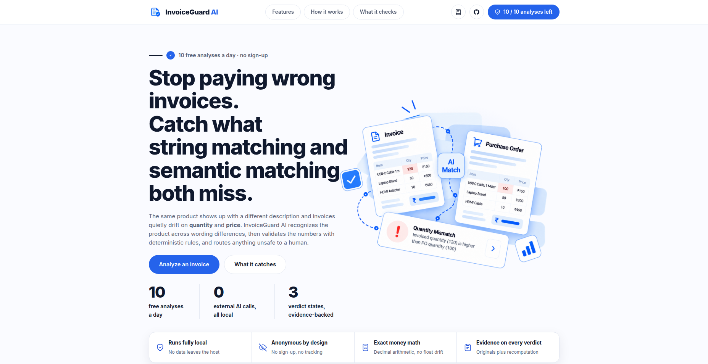

<div align="center">
  <h1>InvoiceGuard AI</h1>
  <p><em>AI-assisted invoice ↔ Purchase Order mismatch detection: find the product across different wording, then check every quantity and price with deterministic rules and route anything unsafe to human review.</em></p>
  <p>
    <code>Python 3.12+</code>&nbsp;
    <code>FastAPI</code>&nbsp;
    <code>SQLAlchemy</code>&nbsp;
    <code>Pydantic v2</code>&nbsp;
    <code>RapidFuzz</code>&nbsp;
    <code>fastembed (BGE-small, ONNX)</code>&nbsp;
    <code>Pytest</code>
  </p>
  <br/>
  
</div>

---

## Why this exists

Businesses compare supplier invoices against Purchase Orders (POs) before paying. Two failure modes defeat naive tooling:

1. **String comparison fails**: the same product is described differently.
2. **Semantic matching succeeds at identifying the product, and then looks past the money.**

The motivating case:

| | Purchase Order | Invoice |
|---|---|---|
| Description | USB-C Cable, 1 Meter | Type-C Charging Cable, 100cm |
| Quantity | 100 | **120** |
| Unit price | ₹150.00 | ₹150.00 |

These describe the same product (1 m = 100 cm), but no substring of one appears in the other. A lexicographic tool reports "product not found." A purely semantic tool happily matches them and waves through the **20 extra units being billed (₹3,000 of potential over-billing, before taxes)**.

InvoiceGuard AI does both jobs: it recognizes the product across different wording, then validates the numbers with deterministic rules, and **routes anything unsafe to a human instead of silently passing it**.

### Expected output for the example above

```
Status:             NEEDS_REVIEW
Match:              "Type-C Charging Cable, 100cm"  →  "USB-C Cable, 1 Meter"
Match method:       SEMANTIC (potential match; identity not proven)
Quantity:           invoiced 120 vs ordered 100     → difference +20 units
Potential excess:   ₹3,000.00  (20 × PO unit price ₹150.00, before applicable taxes)
Recommended action: Confirm product identity and quantity with the supplier before payment.
```

Every flagged discrepancy ships with the original values and the arithmetic behind it, never a bare "mismatch" score.

---

## What it does

| Feature | Detail |
|---|---|
| Invoice & PO input | Invoice as PDF or image; PO as structured JSON/CSV (manual entry optional) |
| Invoice field extraction | Vendor, invoice number, PO number, currency, line items (description, quantity, unit price, line total), subtotal/total when present |
| Intelligent line-item matching | SKU → exact → fuzzy → semantic, with contradiction checks (see below) |
| Quantity & price validation | Deterministic `Decimal` math with configurable tolerances |
| Discrepancy detection | Quantity excess/shortfall, unit-price deviation, line-total inconsistency, sub-total/total inconsistency, currency and unit conflicts, missing data |
| Readable results | Status, matches with confidence, itemized discrepancies with explanations, recommended next action |
| Anonymous usage limits | 10 successful validations per anonymous session per day, enforced server-side |
| IP abuse protection | 8 analyses/minute and 100 lifetime per client IP, enforced server-side (session rotation can't bypass it) |
| AI-agent access | MCP server wrapper (`invoiceguard_mcp.py`) exposing analyze + usage as tools for coding assistants |
| Tests & docs | Pytest suite over matching, financial rules, usage limiting, rate limiting, and API |

**Explicitly out of scope:** no login/registration, no RBAC, no payments, no ERP integrations, no vector DB (embeddings run in-process), no workflow engines. A focused prototype, not an enterprise platform.

## How matching works

```
Invoice (PDF/image) ─┐
                     ├─► extraction ─► normalization ─► hybrid matching ─► financial validation ─► decision + report
PO (JSON/CSV)       ─┘
```

| Stage | What happens | Guarantee |
|---|---|---|
| 1 · Normalize | NFKC + lowercase + punctuation cleanup, unit canonicalization (`"1 Meter"` → `1 m`, `"100cm"` → `100 cm`), Indian/US digit-group-aware number parsing. Originals are always preserved for display and audit | Meaningful specs (sizes, voltages, model numbers like `USB-C 3.2 Gen-1`) are never stripped |
| 2 · Exact | Match on SKU identifiers, then on normalized descriptions | Equal SKUs with wildly different descriptions are treated as a contradiction, not a match |
| 3 · Fuzzy | RapidFuzz token-sort similarity (threshold **85/100** by default) | Textually similar candidates only |
| 4 · Semantic | `BAAI/bge-small-en-v1.5` sentence embeddings via fastembed/ONNX, no torch, runs in-process (cosine threshold **0.72** by default) | Similarity is **candidate evidence, never proof of identity** |
| 5 · Financial | Pure-python `Decimal` (`ROUND_HALF_UP`), compare quantities, unit prices, line totals, stated subtotal/total | No floating point anywhere near money; contradicting basis ⇒ no monetary claim at all |
| 6 · Decide | Combine evidence | High similarity can never override a numeric discrepancy |

### The decision rules

| Condition | Overall status |
|---|---|
| Every line matched with strong evidence; all numeric checks pass; totals consistent | `MATCHED` |
| Reliable match(es) with an identified discrepancy (quantity, price, totals, missing PO item) | `DISCREPANCY_FOUND` |
| Ambiguous match (near-tie candidates), SKU contradictions, incompatible units/currency, missing financial data, unreliable extraction | `NEEDS_REVIEW` |

`NEEDS_REVIEW` always wins when evidence is weak. A `MATCHED` result is a *finding*, not a payment authorization; nothing here auto-approves money.

### Guardrails baked into the engine

- **Never invent values.** If a quantity or price can't be extracted, the line is marked `MISSING_FINANCIAL_DATA` instead of filled in.
- **Never compute money on an incompatible basis.** If units differ (e.g. `pcs` vs `meters`) or currencies conflict, quantity/price *money* comparisons are suppressed and the case is flagged for review; no bogus ₹ figure is ever produced.
- **Check strong identifiers for contradictions.** A SKU match with a contradictory description, or a `1 Meter` vs `2 Meter` spec conflict (canonicalized to mm with a 1% tolerance so `1 m` vs `1000 mm` never trips it), demotes the match to a review case.
- **Ambiguity is explicit.** When two PO lines score within the ambiguity gap (default **0.05**), neither is chosen silently; both are reported.
- **Fail softly, honestly.** If the embedding model can't load, the matcher degrades to fuzzy matching and the report says `semantic_matching_available: false` rather than pretending.

The motivating example demonstrates exactly why unit handling matters: `"USB-C Cable, 1 Meter"` and `"Type-C Charging Cable, 100cm"` both normalize to a length of **1000 mm**, so units are compatible (1 m ↔ 100 cm are both lengths) and the `+20 × ₹150 = ₹3,000` excess can be computed confidently, which a system that only string-compared units would refuse to do.

---

## Architecture

```
backend/app/
├── config.py             # All tunables via INVOICEGUARD_* env vars (.env supported)
├── database.py           # SQLite engine (WAL mode, busy timeouts), per-path engine cache
├── models.py             # SQLAlchemy models: usage_daily (concurrency-safe counters)
├── schemas.py            # Pydantic v2 API contracts & report models
├── normalizer.py         # Stage 1: text/number/currency/unit normalization, spec extraction
├── matching.py           # Stages 2 to 4: SKU/exact/fuzzy/semantic matcher + contradiction checks
├── financial_validator.py# Stage 5: deterministic Decimal validation & discrepancy generation
├── analysis_service.py   # Stage 6: decision assembly & report
├── usage_limiter.py      # Anonymous daily limit with atomic reservation
├── document_parser.py    # PDF text parser + OCR for scans
├── api.py                # FastAPI routes
└── main.py               # App entrypoint (exports the UI in full-stack mode)

frontend/                 # Vanilla HTML/CSS/JS single page (no build step)
├── index.html            # Landing + workbench; anchors into the sections below
├── style.css             # Design system following the mockups in design/
├── app.js                # Session id, usage pill, analyze flow, report rendering
└── assets/               # Logo, hero illustration, landing screenshot, bundled sample invoice

samples/                  # Demo data for the worked example (regenerate via scripts/make_samples.py)
scripts/                  # Utility scripts
```

Design notes:

- `matching.py`, `financial_validator.py`, and `normalizer.py` are **pure logic**: no I/O, no model calls inside the money path, which is what makes the spec's test cases (exact match, quantity mismatch, ambiguous semantic match, …) unit-testable with plain values.
- The extraction layer (`document_parser.py`) is deliberately modular so the parser can be swapped without touching validation logic.
- Semantic embedding is a local ONNX model, so there is **no external AI API key, no per-request cost, and no data leaves the machine**.
- SQLite (WAL) is the storage of record for the prototype; the schema is small and would port to PostgreSQL unchanged.

## API

Three endpoints, nothing more.

### `POST /api/v1/analyze`

Multipart form: the invoice file (`pdf`, `png`, `jpg`, `jpeg`, `webp`; max 10 MB), the PO as a JSON/CSV file (or inline JSON), and the anonymous session ID.

```bash
curl -X POST http://localhost:8000/api/v1/analyze \
  -H "X-Session-ID: anon-9f2a7c4e1" \
  -F "invoice=@samples/invoice_sample.pdf" \
  -F "purchase_order_file=@samples/po_sample.json"
```

Illustrative response for the worked example:

```json
{
  "status": "NEEDS_REVIEW",
  "summary": "1 invoice line matched 1 PO line. Invoice bills 20 units more than the PO promises.",
  "recommended_action": "Confirm the product identity and the billed quantity with the supplier before payment.",
  "invoice_currency": "INR",
  "matches": [{
    "invoice_description": "Type-C Charging Cable, 100cm",
    "po_description":       "USB-C Cable, 1 Meter",
    "matched": true,
    "method": "SEMANTIC",
    "semantic_score": 0.83,
    "confidence": "MEDIUM",
    "contradictions": [],
    "unit_compatible": true
  }],
  "discrepancies": [{
    "type": "QUANTITY_MISMATCH",
    "severity": "WARNING",
    "line_ref": "Type-C Charging Cable, 100cm",
    "invoice_value": "120",
    "po_value": "100",
    "difference": "20",
    "potential_excess_amount": 3000.00,
    "explanation": "The invoice quantity exceeds the promised quantity on the matched PO line by 20 units. Applying the PO unit price (₹150.00), the potential excess is ₹3,000.00 before applicable taxes. The PO price is used because it is the agreed comparison basis."
  }],
  "usage": { "daily_limit": 10, "successful_validations": 4, "remaining_validations": 6,
             "timezone": "Asia/Kolkata", "reset_at": "2026-10-24T00:00:00+05:30" }
}
```

*Sample output for illustration; a live run's similarity score depends on the loaded embedding model.*

### `GET /api/v1/usage`

```bash
curl -H "X-Session-ID: anon-9f2a7c4e1" http://localhost:8000/api/v1/usage
```

Returns the daily limit (10), successful validations so far today, remaining allowance, and the next IST-midnight reset time.

### `GET /health`

Simple service health response used by the frontend and monitors.

---

## Using it from AI agents (MCP)

The platform is not just a web page — it is a public REST API (self-documented at `/docs`), and an MCP server (`invoiceguard_mcp.py` at the repository root) wraps that API so coding assistants can run invoice reviews as tool calls.

```
pip install fastmcp httpx
python invoiceguard_mcp.py        # stdio transport
```

Register it in an MCP client (Claude Desktop, Cursor, OpenCode, …):

```json
{
  "mcpServers": {
    "invoiceguard": {
      "command": "python",
      "args": ["/absolute/path/to/InvoiceGuard AI/invoiceguard_mcp.py"]
    }
  }
}
```

Two tools are exposed:

| Tool | What it does |
|---|---|
| `analyze_invoice(invoice_path, purchase_order_path, session_id?)` | Uploads the files to the live API and returns the full verdict JSON (status, matches, discrepancies with amounts). |
| `usage(session_id)` | Remaining anonymous-session validations for today (IST reset). |

The server targets the deployed API by default (`INVOICEGUARD_API_URL` overrides it), so transient-layer limits below are enforced by the platform itself — the wrapper adds no policy of its own and surfaces `429` responses (message, code, retry hints) verbatim to the agent.

---

## Anonymous usage limit: 10/day, enforced where it matters

No login, no email, no cookies for accounts. Just a random session ID the browser generates once (stored in local storage) and sends with each request.

Where the enforcement lives and why:

- **The server computes "today"** on the `Asia/Kolkata` calendar (never trusts client dates) and validates the session ID format (`^[A-Za-z0-9_-]{8,64}$`) before doing any work.
- **Capacity is reserved before expensive work.** Each in-flight analysis atomically bumps a `reserved_count` inside `usage_daily`; the row carries a unique constraint on `(session_id, usage_date)`:
  - success ⇒ reserved unit is converted into `successful_validation_count`;
  - failure ⇒ the reservation is released. Rejects, invalid uploads, extraction errors, and infrastructure failures **do not consume the allowance**.
- **Concurrency-safe.** WAL mode plus the reserve-then-commit pattern means parallel requests cannot exceed 10 even when they arrive simultaneously; the 11th successful validation gets `429 Too Many Requests`.
- **Leak protection.** Reservations older than a TTL (default 15 min) are reclaimed so a crashed request cannot permanently eat capacity.
- **Honest limitation.** Anonymous browser sessions are not real identity; clearing storage gets a fresh allowance. The mechanism exists to demonstrate correct backend rate limiting (atomicity, uniqueness, day rollover), not enterprise-grade abuse prevention. The UI shows `Daily analyses remaining: 7 / 10`, and disables the action with a "resets at midnight IST" message when the allowance is exhausted.

---

## IP rate limiting: 8/minute and 100 lifetime, enforced server-side

Because session IDs are client-supplied and rotatable, a second, identity-agnostic layer protects the expensive `/analyze` endpoint by **client IP** (`X-Forwarded-For` when behind the proxy, otherwise the socket address) in `backend/app/rate_limiter.py`:

- **8 analyses per rolling minute** per IP — the 9th within the same minute gets `429 RATE_LIMIT_MINUTE` with a `Retry-After` header counting down to the next minute bucket.
- **100 analyses lifetime** per IP — gets `429 RATE_LIMIT_LIFETIME`. The counter lives in the same SQLite database; on ephemeral hosting (Render free tier) it resets when the service is redeployed or restarted, and the 429 message says exactly that.
- **Only admitted requests count.** The atomic single-statement upsert (`INSERT … ON CONFLICT … WHERE … RETURNING`) increments both counters exclusively when both caps still have room — a denied burst cannot silently drain the lifetime budget.
- **Rotating session IDs does not bypass it.** A script that minted fresh anonymous sessions every request is capped at the IP level instead.

Honest caveats: clients sharing one egress IP (office/campus NAT) share these caps, and the lifetime counter is only as durable as the service disk. Strictness was chosen deliberately: for a free-tier demo the risk profile is scripts, not humans.

---

## Tech stack

| Layer | Choice | Why |
|---|---|---|
| Backend | Python, FastAPI, Pydantic v2 | Minimal, typed, fast async API |
| ORM / DB | SQLAlchemy 2.x, SQLite (WAL) | Zero-config persistence; portable schema |
| Fuzzy matching | RapidFuzz | Fast, dependency-light token similarity |
| Semantic matching | fastembed (`BAAI/bge-small-en-v1.5`, ONNX) | Local sentence embeddings without torch or external APIs |
| Money math | Python `Decimal` (`ROUND_HALF_UP`) | Exact currency arithmetic; no float drift |
| Documents | `pypdf` for text PDFs; OCR (`pytesseract` + `tesseract-ocr` + `poppler-utils`) for scans | Text PDFs parsed directly; images OCR'd; the parser fails explicitly when OCR tooling is absent instead of inventing content |
| Frontend | Vanilla HTML/CSS/JS, no build step | One page served by the backend at `/`; anonymous session id in localStorage; zero npm dependencies |
| Tests | Pytest (+ its async/client plugin) | Small, meaningful suite (below) |

## Configuration

Every value is overridable with `INVOICEGUARD_*` environment variables (or a local `.env`). Key ones:

| Variable | Default | Purpose |
|---|---|---|
| `INVOICEGUARD_DAILY_LIMIT` | `10` | Successful validations per session per day |
| `INVOICEGUARD_RATE_LIMIT_PER_MINUTE` | `8` | Analyses per rolling minute per client IP |
| `INVOICEGUARD_RATE_LIMIT_LIFETIME` | `100` | Analyses in the database lifetime per client IP |
| `INVOICEGUARD_TIMEZONE_NAME` | `Asia/Kolkata` | Calendar day for usage rollover |
| `INVOICEGUARD_DB_PATH` | `data/invoiceguard.db` | SQLite file path |
| `INVOICEGUARD_MAX_UPLOAD_BYTES` | `10485760` | Max invoice upload size |
| `INVOICEGUARD_DEFAULT_CURRENCY` | `INR` | Fallback currency |
| `INVOICEGUARD_FUZZY_THRESHOLD` | `85.0` | RapidFuzz 0 to 100 cutoff |
| `INVOICEGUARD_SEMANTIC_THRESHOLD` | `0.72` | Cosine similarity cutoff |
| `INVOICEGUARD_AMBIGUOUS_SCORE_GAP` | `0.05` | Top-2 gap below which a match is ambiguous |
| `INVOICEGUARD_EMBEDDING_MODEL` | `BAAI/bge-small-en-v1.5` | Sentence embedding model |
| `INVOICEGUARD_PRICE_TOLERANCE_PCT` | `0.005` | 0.5% price/line-total tolerance |
| `INVOICEGUARD_ABSOLUTE_PRICE_TOLERANCE` | `0.01` | Absolute tolerance floor |
| `INVOICEGUARD_SHORTFALL_AS_DISCREPANCY` | `false` | Bill-less-than-PO treated as info, not warning |

See `backend/app/config.py` for the full list. A `.env.example` ships with the repository.

## Getting started

Prerequisites: **Python 3.12+** (developed on 3.14).

```bash
git clone https://github.com/Kaushalendra-Marcus/InvoiceGuard-AI.git
cd InvoiceGuard-AI

python -m venv .venv && source .venv/bin/activate
pip install -r backend/requirements.txt

uvicorn backend.app.main:app --reload        # API + UI → http://localhost:8000
```

Open `http://localhost:8000`, press **Load sample input**, then **Analyze Invoice**: the worked example runs without preparing any data.

Prefer `npm` muscle memory? `frontend/package.json` ships thin wrapper scripts (the frontend itself stays dependency-free; these only drive the Python server):

```bash
cd frontend
npm run setup   # one-time: creates .venv and installs backend requirements
npm run dev     # uvicorn with hot reload → http://localhost:8000
npm test        # backend test suite
```

The pages themselves (`index.html`, `app.html`) are plain HTML/CSS/JS with no build step.</think><tool_call>edit<arg_key>newString</arg_key><arg_value>Open `http://localhost:8000`, press **Load sample input**, then **Analyze Invoice**: the worked example runs without preparing any data.

Run the tests:

```bash
pytest backend/tests -v
```

## Testing

The suite targets the spec's fourteen core cases, matching and money first:

- **Matching:** exact match with clean numbers · different descriptions, same product (the motivating case) · ambiguous semantic near-tie → `NEEDS_REVIEW` · missing/contradictory SKU · incompatible units suppress money math
- **Financial:** quantity mismatch (+excess, −shortfall) · unit-price mismatch · line-total internal inconsistency · subtotal/total inconsistency · missing financial data never fabricated
- **Usage limiter:** successful validation increments the counter · failed validation releases the reservation without consuming allowance · 11th validation of the day rejected with `429` · parallel requests never exceed the limit · usage resets on the next Asia/Kolkata day · day computed by the server, never the client
- **API:** document validation, sample end-to-end

All examples are synthetic invoices/POs; no real vendor data in the repository.

## Deployment

- **Render (full app: frontend + API in one service):** configuration is mirrored in [`render.yaml`](render.yaml). Build: `pip install -r backend/requirements.txt && python scripts/prefetch_model.py` (bakes the ~65 MB BGE-small ONNX model into the deploy image, so cold starts don't re-download it); start: `uvicorn backend.app.main:app --host 0.0.0.0 --port $PORT`. The free plan has an ephemeral disk, so the usage SQLite database resets on every redeploy or restart. That is acceptable for a demo and is documented here so nobody is surprised.
- **Vercel (static mirror):** [`frontend/vercel.json`](frontend/vercel.json) serves the frontend statically and proxies `/api/v1/*`, `/samples/*`, `/health` and `/docs` to the Render service, keeping every browser call same-origin (no CORS changes needed).

## Known limitations

- Anonymous sessions are revocable by clearing browser storage; acceptable for a rate-limiting demo, weak against determined abuse.
- Description-level spec extraction currently covers length and weight (canonicalized to mm/mg); other dimensions (color, voltage) are not contradiction-checked.
- Extraction quality depends on document layout; a failure yields explicit `MISSING_FINANCIAL_DATA`/review states, never guessed values.
- Taxes, discounts, and multi-currency POs are treated as out of scope; totals are cross-checked only when the needed fields exist.
- SQLite suits the single-node prototype; PostgreSQL is the natural next step for concurrent deployment.

## The story

> *I studied Peakflo's finance automation workflows and built a focused prototype addressing a specific invoice-validation problem: descriptions vary even when they mean the same product, and quantities/prices can silently drift. InvoiceGuard AI combines semantic matching (local BGE-small embeddings) with deterministic `Decimal`-based financial rules so a similarity score can never excuse a wrong number; ambiguous or risky cases are routed to explicit `NEEDS_REVIEW` instead of an unsafe auto-decision. It also implements a backend-enforced daily limit of 10 successful validations per anonymous session using atomic, concurrency-safe reservations, and the whole core engine is covered by synthetic-example tests.*

---

*Built as a focused prototype for Forward Deployed Engineer / ML Engineer internship applications; deliberately small, deliberately honest about what it does and doesn't do.*
